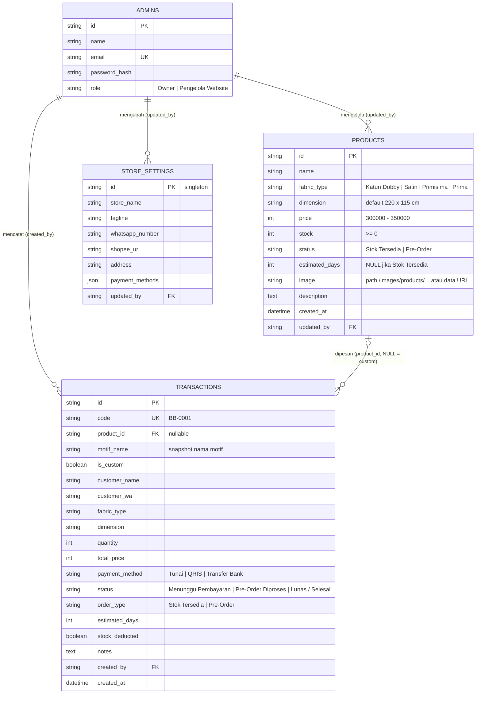

# BATIK BUJANG — Katalog Kain Batik Lembaran Khas Riau

> *bangga beradat, tampil bergaya*

Etalase katalog publik + panel admin untuk UMKM Batik Bujang. Dibangun dengan **Vue 3 (`<script setup>`)**, **Vite**, **Tailwind CSS 3**, **Vue Router 4**, dan **Pinia**. Tanpa backend: seluruh data disalin dari `src/seed/*.json` ke `localStorage` saat pertama kali dibuka.

## Cara menjalankan

```bash
npm install
npm run dev        # http://localhost:5173
npm run build      # hasil produksi di folder dist/
npm run preview    # uji hasil build
```

Kredensial awal (dari `src/seed/admins.json`):

| Role | Email | Password |
|---|---|---|
| Owner | `owner@batikbujang.id` | `owner12345` |
| Pengelola Website | `admin@batikbujang.id` | `admin12345` |

Ubah email/password lewat **/admin/pengaturan > Akun admin**, atau edit `src/seed/admins.json` lalu jalankan **Reset Data ke JSON Seed Awal** (seed hanya dibaca saat `localStorage` masih kosong).

Nomor WhatsApp (`6281234567890`), link Shopee, dan alamat di `src/seed/settings.json` adalah **contoh**. Ganti lewat **/admin/pengaturan > Profil toko**.

## Foto produk dan logo

| Folder | Isi |
|---|---|
| `public/images/products/` | Foto produk `.jpg/.jpeg/.png/.webp`. Seed menunjuk `produk-1.jpg` s.d. `produk-8.jpg`. |
| `public/images/brand/` | Logo toko dengan nama persis `logo-batik-bujang.png`. |

Cara menambah foto manual:

1. Salin file ke `public/images/products/` (disarankan rasio 4:5, lebar 800-1200 px, di bawah ~500 KB).
2. **Motif seed:** beri nama sesuai `produk-N.jpg`, lalu refresh browser.
3. **Motif baru:** buka `/admin/katalog` > *Tambah motif* > **Opsi A: Path folder** > ketik `/images/products/nama-file.jpg` (nama file saja juga diterima). Preview langsung tampil.
4. **Opsi B: Upload** membaca file lokal menjadi Data URL (diperkecil otomatis) dan menyimpannya di `localStorage` browser tersebut saja.

Jika foto/logo belum ada, aplikasi otomatis memakai ilustrasi motif emas (produk) atau ikon SVG huruf "B" (logo). Tidak pernah tampil ikon gambar rusak.

## Aturan bisnis yang diterapkan

- Produk hanya **kain lembaran** `220 x 115 cm` (request ukuran khusus lewat WhatsApp), 4 jenis kain, harga Rp300.000-Rp350.000.
- **Stok > 0 = `Stok Tersedia`; stok 0 = `Pre-Order`.** Status selalu mengikuti stok, baik di form produk maupun saat order mengurangi stok.
- Pembeli tidak checkout. Tombol **Pesan via WhatsApp** membuka `https://wa.me/<nomor>?text=...` dengan pesan otomatis (motif, kain, ukuran, harga, status).
- **Pencatatan order (admin):** order dari produk berstok mengurangi stok otomatis; jika stok jadi 0, produk otomatis `Pre-Order`. Produk Pre-Order atau request custom tidak mengubah stok. Menghapus order mengembalikan stok yang pernah dipotong. Edit order mengunci motif/kain/jumlah agar stok konsisten.
- **Cek pesanan publik** (`/cek-pesanan`): cari dengan Kode Pesanan (mis. `BB-0002`) atau Nomor WA. Nama pelanggan disamarkan (`An**** Pu***`).
- Route `/admin/*` dilindungi `beforeEach` guard: belum login diarahkan ke `/login` dengan notifikasi; admin yang sudah login membuka `/login` diarahkan ke `/admin/dashboard`.

## Persistensi (localStorage)

Setiap store punya `initializeStore()` yang dipanggil di `src/main.js` **sebelum** router aktif:

1. Cek key `bb_admins`, `bb_products`, `bb_transactions`, `bb_settings`, `bb_session`.
2. Jika kosong: salin dari `src/seed/*.json` ke state dan langsung simpan.
3. Jika ada: muat dari `localStorage`. Setiap perubahan state berikutnya otomatis ditulis (watcher `deep`).

## Panduan gaya visual

| Token | HEX | Pemakaian |
|---|---|---|
| Emas Riau (primary) | `#C59B43` | Tombol utama, aksen, logo |
| Emas hover | `#AD8332` | Hover, teks emas pada latar terang |
| Emas lembut | `#FBF7EE` | Latar soft, badge, placeholder |
| Hitam Adat | `#18181B` | Hero, sidebar, footer, teks |
| Krem Gading | `#FAF8F5` | Latar halaman |
| Sukses / Stok Tersedia | `#15803D` (bg `#DCFCE7`) | Badge stok, lunas |
| Peringatan / Pre-Order | `#B45309` (bg `#FEF3C7`) | Badge Pre-Order |
| Bahaya / Error | `#B91C1C` (bg `#FEE2E2`) | Validasi, hapus |

Tipografi: **Playfair Display** (nama brand, heading) dan **Plus Jakarta Sans** (teks isi, tabel, tombol), dimuat dari Google Fonts di `index.html`. Warna dan font terdaftar di `tailwind.config.js`; komponen kelas (`.btn`, `.input`, `.card`, `.chip`) ada di `src/assets/main.css`.

## Hirarki komponen

```text
App.vue
├── ToastNotification
├── PublicLayout
│   ├── NavbarPublic ── BrandLogo, IconBase
│   ├── <RouterView>
│   │   ├── HomeCatalogView
│   │   │   ├── HeroSection ── WhatsAppOrderButton
│   │   │   ├── ProductFilterBar
│   │   │   └── ProductCard ×N ── StatusBadge, WhatsAppOrderButton
│   │   ├── ProductDetailView ── StatusBadge, WhatsAppOrderButton, ProductCard ×4
│   │   └── OrderCheckView ── StatusBadge, WhatsAppOrderButton
│   ├── FooterPublic ── BrandLogo
│   └── WhatsAppOrderButton (variant="floating")
├── LoginView ── BrandLogo
└── AdminLayout
    ├── SidebarAdmin ── BrandLogo
    └── <RouterView>
        ├── DashboardView ── StatsCard ×4, StatusBadge
        ├── CatalogManageView ── StatusBadge, ProductFormModal (BaseModal), ConfirmDialog (BaseModal)
        ├── TransactionManageView ── StatusBadge, TransactionFormModal (BaseModal),
        │                            ReceiptPrintModal (BaseModal), ConfirmDialog
        └── SettingsManageView ── ConfirmDialog
```

### Props dan emits komponen reusable

| Komponen | Props | Emits |
|---|---|---|
| `BrandLogo` | `size` (`sm`/`md`/`lg`), `showTagline` (Boolean), `inverse` (Boolean) | - |
| `StatusBadge` | `status` (String, wajib), `tone` (String), `size` (`sm`/`md`) | - |
| `BaseModal` | `modelValue` (Boolean), `title`, `size` (`sm`/`md`/`lg`/`xl`), `persistent` | `update:modelValue`, `close` |
| `ConfirmDialog` | `modelValue`, `title`, `message`, `confirmText`, `cancelText`, `variant` (`danger`/`primary`) | `update:modelValue`, `confirm`, `cancel` |
| `ToastNotification` | - (membaca composable `useToast`) | - |
| `StatsCard` | `label`, `value`, `hint`, `icon`, `tone` (`gold`/`success`/`warning`/`dark`) | - |
| `IconBase` | `name`, `size`, `stroke` | - |
| `ProductCard` | `product` (Object, wajib) | `order` |
| `ProductFilterBar` | `modelValue` ({search, fabric, status}), `fabricOptions`, `statusOptions`, `resultCount` | `update:modelValue`, `reset` |
| `WhatsAppOrderButton` | `product` (Object/null), `label`, `variant` (`primary`/`outline`/`floating`), `block`, `small` | `click` |
| `HeroSection` | `store`, `shopeeUrl`, `dimension`, `priceRange`, `fabricNames` | `browse` |
| `SidebarAdmin` | `user`, `open` | `close`, `logout` |
| `ProductFormModal` | `modelValue`, `product` (null = tambah) | `update:modelValue`, `saved` |
| `TransactionFormModal` | `modelValue`, `transaction` (null = baru) | `update:modelValue`, `saved` |
| `ReceiptPrintModal` | `modelValue`, `transaction` | `update:modelValue` |

## Pemetaan halaman

| Route | Role | Fitur |
|---|---|---|
| `/` | Publik | Hero, katalog, pencarian, filter jenis kain dan status, cara pesan, info bahan |
| `/produk/:id` | Publik | Foto, jenis kain, dimensi 220 x 115 cm, harga, badge status, WhatsApp, Shopee, metode bayar |
| `/cek-pesanan` | Publik | Cek progres order via Kode Pesanan / Nomor WA |
| `/login` | Publik (redirect bila sudah login) | Login email + password |
| `/admin/dashboard` | Admin | Statistik, stok menipis/PO, order terbaru |
| `/admin/katalog` | Admin | CRUD motif, foto (path/upload), status + stok, hapus dengan konfirmasi |
| `/admin/transaksi` | Admin | Catat order WA/PO, ubah status, cetak nota, export CSV, hapus |
| `/admin/pengaturan` | Admin | Ubah 2 akun, profil toko, metode bayar, reset seed |

## Kontrak API (`/api/v1/*`)

Aplikasi saat ini memakai store + localStorage. `src/services/mockApiContract.js` memuat daftar endpoint (`API_CONTRACT`) dan `mockApi` yang mengembalikan `{ status, data | error }` sehingga mudah diganti `fetch` ke backend nyata. Admin memakai header `Authorization: Bearer <token>`.

| Method | Endpoint | Akses | Sukses | Gagal |
|---|---|---|---|---|
| POST | `/api/v1/auth/login` | Publik | 200 | 400, 401 |
| GET | `/api/v1/products` | Publik | 200 | - |
| GET | `/api/v1/products/:id` | Publik | 200 | 404 |
| POST | `/api/v1/products` | Admin | 201 | 400, 401, 403 |
| PUT | `/api/v1/products/:id` | Admin | 200 | 400, 401, 403, 404 |
| DELETE | `/api/v1/products/:id` | Admin | 200 | 401, 403, 404 |
| GET | `/api/v1/transactions` | Admin | 200 | 401, 403 |
| GET | `/api/v1/transactions/lookup?q=` | Publik | 200 | 400 |
| POST | `/api/v1/transactions` | Admin | 201 | 400, 401, 403 |
| PATCH | `/api/v1/transactions/:id` | Admin | 200 | 400, 401, 403, 404 |
| GET | `/api/v1/settings` | Publik | 200 | - |
| PUT | `/api/v1/settings` | Admin | 200 | 400, 401, 403 |

### `POST /api/v1/auth/login`

```json
// Request
{ "email": "owner@batikbujang.id", "password": "owner12345" }
// 200
{ "token": "<jwt>", "user": { "id": "adm-owner", "name": "Owner Batik Bujang", "email": "owner@batikbujang.id", "role": "Owner" } }
// 400
{ "error": { "message": "Password wajib diisi.", "errors": {} } }
// 401
{ "error": { "message": "Email atau password salah.", "errors": {} } }
```

### `/api/v1/products`

```json
// POST Request (Admin)
{ "name": "Pucuk Rebung", "fabricType": "Katun Dobby", "dimension": "220 x 115 cm", "price": 320000,
  "stock": 6, "status": "Stok Tersedia", "estimatedDays": null, "image": "/images/products/produk-1.jpg",
  "description": "Motif tunas bambu muda." }
// 201
{ "id": "prd-001", "name": "Pucuk Rebung", "fabricType": "Katun Dobby", "dimension": "220 x 115 cm", "price": 320000,
  "stock": 6, "status": "Stok Tersedia", "estimatedDays": null, "image": "/images/products/produk-1.jpg",
  "description": "Motif tunas bambu muda.", "createdAt": "2026-11-21T09:00:00+07:00" }
// 400
{ "error": { "message": "Validasi gagal.", "errors": { "name": "Nama motif wajib diisi.", "price": "Harga harus lebih dari 0.", "stock": "Stok harus bilangan bulat 0 atau lebih." } } }
// 401  { "error": { "message": "Silakan login terlebih dahulu." } }
// 403  { "error": { "message": "Akun tidak memiliki izin mengubah katalog." } }
// GET /api/v1/products -> 200: [ { ...produk }, ... ]
```

### `/api/v1/transactions`

```json
// POST Request (Admin)
{ "customerName": "Andini Putri", "customerWa": "081234567802", "productId": "prd-003", "customMotif": "",
  "fabricType": "Katun Primisima", "dimension": "220 x 115 cm", "quantity": 2, "totalPrice": 660000,
  "paymentMethod": "QRIS", "status": "Pre-Order Diproses", "notes": "DP masuk" }
// 201
{ "id": "trx-002", "code": "BB-0002", "customerName": "Andini Putri", "customerWa": "6281234567802",
  "productId": "prd-003", "motifName": "Siku Keluang", "isCustom": false, "fabricType": "Katun Primisima",
  "dimension": "220 x 115 cm", "quantity": 2, "totalPrice": 660000, "paymentMethod": "QRIS",
  "status": "Pre-Order Diproses", "orderType": "Pre-Order", "estimatedDays": 14, "stockDeducted": false,
  "createdBy": "adm-owner", "createdAt": "2026-11-08T14:15:00+07:00" }
// 400
{ "error": { "message": "Validasi gagal.", "errors": { "quantity": "Stok Pucuk Rebung hanya 6 lembar. Kurangi jumlah atau catat sebagai request custom." } } }
// GET /api/v1/transactions/lookup?q=BB-0002 -> 200: [ { ...order } ]   (publik: nama disamarkan di klien)
// PATCH /api/v1/transactions/:id  { "status": "Lunas / Selesai" } -> 200: { ...order }
```

### `/api/v1/settings`

```json
// PUT Request (Admin)
{ "whatsappNumber": "081234567890", "shopeeUrl": "https://shopee.co.id/batikbujang", "address": "Pekanbaru, Riau",
  "paymentMethods": [ { "name": "Tunai" }, { "name": "QRIS" }, { "name": "Transfer Bank" } ] }
// 200
{ "store": { "name": "Batik Bujang", "whatsappNumber": "6281234567890", "shopeeUrl": "https://shopee.co.id/batikbujang", "address": "Pekanbaru, Riau" },
  "paymentMethods": [ { "name": "Tunai" }, { "name": "QRIS" }, { "name": "Transfer Bank" } ] }
// 400 { "error": { "message": "Validasi gagal.", "errors": { "whatsappNumber": "Nomor WhatsApp tidak valid (contoh: 081234567890)." } } }
```

## ERD



Kardinalitas: `ADMINS 1 — N TRANSACTIONS`, `ADMINS 1 — N PRODUCTS`, `ADMINS 1 — N STORE_SETTINGS` (satu baris aktif), `PRODUCTS 0..1 — N TRANSACTIONS` (order custom tidak punya `product_id`). Di versi localStorage ini hanya `transactions.createdBy` yang diisi; `updated_by` disiapkan untuk backend nyata.

## Struktur proyek

```text
public/images/{brand,products}/   logo dan foto produk manual
src/assets/                       main.css (Tailwind + kelas komponen)
src/components/{common,public,admin}/
src/composables/useToast.js
src/layouts/                      PublicLayout, AdminLayout
src/router/index.js               route + beforeEach guard
src/seed/                         admins, products, transactions, settings (.json)
src/services/mockApiContract.js   kontrak endpoint + mock service
src/stores/                       useAuthStore, useProductStore, useTransactionStore, useSettingsStore
src/utils/                        format, storage, whatsapp, placeholder, image, csv, icons, constants
src/views/{public,auth,admin}/
```

## Catatan keamanan

Ini aplikasi front-end murni untuk etalase UMKM. Password admin disimpan apa adanya di `localStorage` dan dapat dibaca siapa pun yang memegang browser tersebut. Untuk produksi dengan data sensitif, pindahkan autentikasi ke backend (hash password, token, otorisasi per role) sesuai kontrak API di atas.
